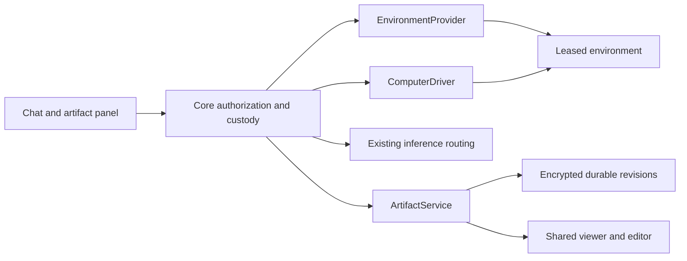

# Visual computer use and durable artifacts

Implementation decision record for [#3703](https://github.com/KestrelSovereignAI/kestrel-sovereign/issues/3703), tracked by [#3707](https://github.com/KestrelSovereignAI/kestrel-sovereign/issues/3707).

Status: contracts under review; runtime and product integration in progress.
This document specifies delivery boundaries, not capabilities already enabled.

## Four independent services

An environment provider acquires a machine. A computer driver observes and
interacts with that machine. The existing inference router chooses a model.
The artifact service owns saved outputs. No service inherits authority from a
name, model response, parent run or resource identifier.

The SDK defines these contracts without a cloud SDK, browser engine or database
dependency. Core implements authorization, lifecycle, persistence, tools and
UI. Provider packages implement environment acquisition and reconciliation.
Driver packages implement actual interaction against a host-admitted connection.

Use separate `kestrel_sovereign.environment_providers` and
`kestrel_sovereign.computer_drivers` entry points. Existing `cloud_providers`
launch agents; `inference_lease_providers` launch inference services. Registering
one does not qualify a package for the other two.

## Existing implementation and cutover

| Current surface | Evidence in the tree | Decision |
| --- | --- | --- |
| Host files and shell | `features/computer_use/feature.py`, `backends/` | Keep explicit host-path and shell grants. Add a separate visual capability; shell consent does not authorize screen/control access. |
| Per-command Docker | `features/compute/executors/docker_executor.py` | Reuse process execution and custody where applicable. A fresh container per call is not a persistent browser session. |
| Generic attachments | `storage/async_file_store.py`, `endpoints/files.py` | Reuse database and encryption. Preserve attachment ownership; do not expose artifact bytes through hash-only attachment URLs. |
| Semantic artifacts | `knowledge/artifact_lifecycle.py` | Evidence/index lifecycle, not the canonical user deliverable store. Index saved source revisions by reference. |
| Workflow artifact metadata | Workflows `operator_runs.py` | Replace deliverable ownership with canonical artifact/revision references. Runs can retain presentation metadata without owning saved content. |
| Sovereignty/constitutional artifacts | `features/sovereignty/artifacts.py`, `constitution/amendment_artifact.py` | Domain records with their own authority rules, not a generic editing service. |

There are no known external consumers requiring compatibility with these new
interfaces. Replace conflicting ownership semantics deliberately; do not add
aliases or a parallel artifact service to avoid a coordinated cutover.

SDK main is 0.40, including the independently tracked native-A2A migration.
Core main currently constrains SDK below 0.40 and imports the removed legacy
A2A API. The Core SDK upgrade must land through #3679 before a runtime PR can
claim normal installation/boot. Candidate-SDK tests in an isolated worktree are
useful development evidence, but do not substitute for the combined host suite.

## Ownership, authority and publication

Canonical identity is `ArtifactRef(artifact_id, revision_id)`. Context links,
source sessions and runs are optional attribution. Deleting a context or
releasing a machine cannot cascade-delete retained artifacts.

Owner scope is the authenticated tenant/principal and optional acting agent.
An absent agent selects the principal's own namespace; it never matches every
agent. Scope is derived from an authenticated `OperatorContext`, not accepted
as proof from HTTP input. Every operation checks current grants, context expiry,
privacy mode and exact owner; IDs, hashes, cursors and receipts grant no access.

Reuse `AsyncDatabase` and SDK encryption. Store artifact blobs in an
owner-scoped namespace with revision references, independent of legacy
`file_owners` attachment claims. This prevents cross-owner hash existence leaks
and lets deletion account for artifact references without erasing attachments.
Private titles, manifests and source bytes are encrypted. Content encryption
must fail closed without an available key.

Publication is a transaction: verify all staged bytes and quotas, compare the
expected current revision, create the immutable revision, update its head, and
persist the complete request digest and receipt atomically. A caller-owned
outer transaction cannot produce a durable receipt. Return success only after
the outermost commit is acknowledged. A lost commit response is reconciled with
the original publication key; no generated replacement key or blind retry.

Staging has a bounded lifetime and owner quota. Expired unreferenced staging may
be collected; committed source revisions may not. Edits conflict rather than
silently overwrite. Deletion compares an expected head, revokes managed views
and removes source references according to retention policy. Receipts may
retain minimal tombstone evidence but cannot resurrect deleted bytes or
private metadata. Exports, caches and indexes participate in deletion.

Privacy and revocation must remain fenced across asynchronous storage and
transport work. A preflight check followed by an unguarded await is inadequate.
Integrate the existing privacy wrapper's active-operation/transition guards;
volatile modes do not publish durable artifacts or retain screen/action logs.
Retention and local-only destination policy apply to materialization as well
as inference and environment selection.

## Interaction and resource custody

Persist the admitted request and accepted quote before acquisition. Quotes bind
exact constraints, owner, region, pinned image, lifetime and cost ceiling. A
lease identifies its accepted quote. Unknown acquire outcomes retain the same
request ID and require reconciliation. Failed/expired resources are not
released resources; retain cleanup custody until physical release is proven.
Unknown actual cost is represented as unknown, never zero.

Pass `DriverConnection` directly into driver open. Host and driver validate
lease and driver IDs, session bounds and expiry before using credentials.
Credentials and private endpoints never enter generic serialization or audit.
All endpoints require authenticated transport; connection loss does not grant
permission to resume. Initial leases have fixed expiry; there is no implicit
renewal through inspect or reconnect.

One controller owns a session. Every action binds a current observation,
control epoch, action ID and deadline. Validate these immediately before an
effect, plus screen bounds and supported actions. Deduplicate accepted actions;
unknown outcomes require status reconciliation instead of replay. Stop fences
input and begins cleanup; process termination remains a distinct lifecycle
operation. A human takeover drains/reconciles accepted actions, advances the
epoch and suspends agent observations. Explicit handback revalidates the screen.

A model click does not establish permission for its side effects. Enforce
network destinations and sensitive operations at the application/egress
boundary. The browser environment has no host filesystem mounts, Docker
socket, cloud metadata access or inherited operator credentials. Remote
providers must meet the same restrictions or decline the capability.

## Provider capability and delivery matrix

| Implementation | Existing ownership | Initial delivery gate |
| --- | --- | --- |
| Local Docker | Core #3709 | Persistent CPU browser, pinned image, bounded resources and lifetime, authenticated connection, restricted egress, Stop/takeover, artifact transfer. Real daemon evidence. |
| Runpod | cloud-runpod #43 | Separate environment adapter; verify actual available CPU/desktop substrate and costs. Do not treat an inference pod as a visual driver. |
| Azure | Core #3713 | Existing cloud-azure repository is archived. Reactivation or replacement ownership is an explicit prerequisite, followed by a viable desktop/browser substrate. |
| AWS | Core #3714 | Establish package/substrate ownership before claiming support; provider adapter must meet the same conformance suite. |
| Local native | Core #3717 | Separate opt-in host-control grant and exposure boundary; excluded from initial release closure. |

No paid cloud resource is created without approval for its concrete resource,
region and spend bound. Docker plus one demonstrated remote provider gates the
first release. Parent closure additionally needs AWS/Azure/Runpod evidence or
an explicitly accepted scope decision; adapter class names do not count.
Credential-profile persistence (#3716) is a separate opt-in follow-up.

## Shared product surface

Artifact cards open the same reusable panel from chat, uploads, tools and
workflow outputs. Text/Markdown/code editing commits a new immutable revision;
image/PDF viewing and download use authenticated revision-bound routes. Render
untrusted content safely; HTML previews need isolation and cannot share host
credentials/origin. No untrusted artifact script executes in the app origin.
The panel shows dirty, saving, saved, conflict, unknown and failed truthfully.
A publication receipt is required for saved state.

The computer view exposes session state, active controller, Stop and takeover.
It links outputs by artifact reference, without embedding lifecycle ownership.
Closing the view or losing its transport does not silently release or resume
the environment. Export and transfer always select an exact source revision.

## Delivery and evidence

1. SDK #85 and Core #3707: contracts, owners, storage/policy decisions.
2. Core #3708/#3709/#3710/#3711: governed runtime, real Docker driver,
   authenticated transport and the shared artifact service/viewer/editor.
3. Core #3712: independently routed local/remote vision with explicit privacy
   and capability refusal. Existing LLM routing remains canonical.
4. Provider tickets and Workflows #39: remote conformance and canonical refs.
5. Core #3715: adversarial tests and an isolated Kite agent on the live path.

Required portability journey: publish revision 1 from Docker, release that
machine, reopen/edit revision 2 in the shared panel, materialize exact revision
2 remotely, and publish revision 3 under the same artifact ID. Verify owner
isolation, revoked authority, quota failures, stale control/edits, lost
acknowledgements, restart reconciliation and physical cleanup.

Before each PR, review the entire worktree diff with Claude CLI Opus 5.5. If
Claude tokens are exhausted, use GPT-6.1 Sol Codex review and disclose the
fallback. Record the complete verdict for the exact candidate, fix findings,
and prove regression guards with failing mutations. Unit tests do not claim
real provider support or a completed live-agent journey.
