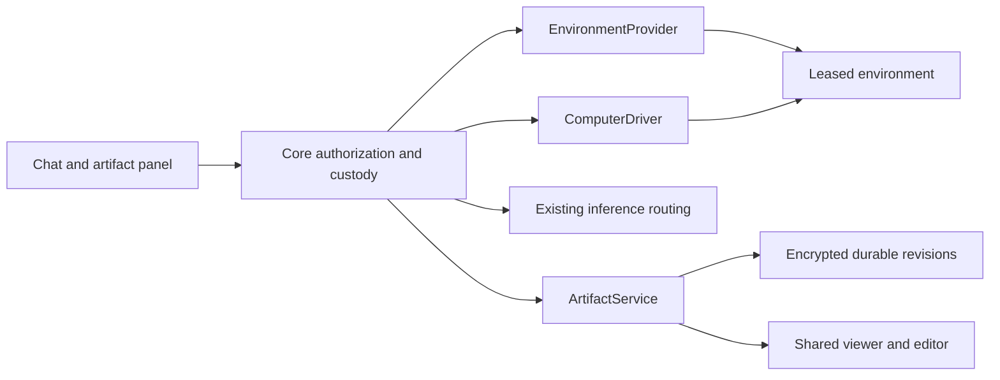

# Visual computer use and durable artifacts

Implementation decision record for [#3703](https://github.com/KestrelSovereignAI/kestrel-sovereign/issues/3703), tracked by [#3707](https://github.com/KestrelSovereignAI/kestrel-sovereign/issues/3707).

Delivery snapshot (2026-10-19): SDK base contracts merged in SDK PR #87;
workspace transfer extension tracked in SDK #86. Runtime and product integration
remain in progress.
This document specifies delivery boundaries, not capabilities already enabled.

## Four independent services

An environment provider acquires a machine. A computer driver observes and
interacts with that machine. The existing inference router chooses a model.
The artifact service owns saved outputs. No service inherits authority from a
name, model response, parent run or resource identifier.

The SDK defines these contracts without a cloud SDK, browser engine or database
dependency. Core implements authorization, lifecycle, persistence, tools and
UI. Provider packages implement environment acquisition and reconciliation.
Driver packages implement actual interaction against a host-admitted connection.

Use separate `kestrel_sovereign.environment_providers` and
`kestrel_sovereign.computer_drivers` entry points. Existing `cloud_providers`
launch agents; `inference_lease_providers` launch inference services. Registering
one does not qualify a package for the other two.

## Existing implementation and cutover

| Current surface | Evidence in the tree | Decision |
| --- | --- | --- |
| Host files and shell | `features/computer_use/feature.py`, `backends/` | Keep explicit host-path and shell grants. Add a separate visual capability; shell consent does not authorize screen/control access. |
| Per-command Docker | `features/compute/executors/docker_executor.py` | Reuse process execution and custody where applicable. A fresh container per call is not a persistent browser session. |
| Generic attachments | `storage/async_file_store.py`, `endpoints/files.py` | Reuse database and encryption. Preserve attachment ownership; do not expose artifact bytes through hash-only attachment URLs. |
| Semantic artifacts | `knowledge/artifact_lifecycle.py` | Evidence/index lifecycle, not the canonical user deliverable store. Index saved source revisions by reference. |
| Workflow artifact metadata | Workflows `operator_runs.py` | Replace deliverable ownership with canonical artifact/revision references. Runs can retain presentation metadata without owning saved content. |
| Sovereignty/constitutional artifacts | `features/sovereignty/artifacts.py`, `constitution/amendment_artifact.py` | Domain records with their own authority rules, not a generic editing service. |

There are no known external consumers requiring compatibility with these new
interfaces. Replace conflicting ownership semantics deliberately; do not add
aliases or a parallel artifact service to avoid a coordinated cutover.

Core's native A2A cutover (#3803, under #3679) consumes the published SDK under
the constraint declared in [pyproject.toml](../../pyproject.toml), including the
computer/artifact contracts introduced in 0.41. SDK 0.40
predates these contracts and is not an artifact runtime dependency.

`ArtifactsFeature` registers the private `/api/artifacts` router through the
host's existing feature lifecycle. Add `ArtifactsFeature` to an agent's feature
allowlist when one is configured. Initialization requires that agent's durable
database, encryption key and privacy persistence gate. It refuses an unavailable
dependency rather than publishing a plaintext or in-memory substitute. Keyless
hosts omit this optional feature during discovery, retain a health diagnostic,
and continue booting their other features. Routes
follow the selected agent and current feature instance, including reloads.
The repository opens lazily inside the first authorized operation. An unavailable
or incorrectly keyed artifact store returns an explicit storage failure without
preventing the agent's other capabilities from starting. Original ciphertext and
envelope keys are preserved; there is no replacement-key fallback. This feature opts out of model subagent dispatch. Its startup-promoted direct
`artifact_publish_text`, `artifact_list`, `artifact_get` and
`artifact_publication_status` tools use the original endpoint caller's revocable
sovereign-key binding and the same service; a peer, unattended wake or delegated
subagent gains no artifact grant. Publication takes a caller-selected original
idempotency key. Successful output parts carry a pinned `ArtifactRef` for the
shared panel, never a second content URL.

The initial host policy admits only a current, configured sovereign API key in
`X-API-Key` or `Authorization: Bearer`. Cookie, JWT, peer, unattended and delegated
callers have no artifact grant. CSRF tokens do not confer one. Context links are
also denied until their destinations have an explicit authority resolver. The
owner is the host sovereign within the original agent DID's tenant; credential
rotation does not change that owner. Request bodies and URLs cannot select it.

The host binds the exact context for the response lifetime, rechecks the current
credential and feature generation at every operation and send, and holds the
existing privacy gate through private delivery. An outer ASGI delivery boundary
acknowledges the final transport send; queuing bytes inside host middleware does
not release that lease. Disable/shutdown revoke admission
before joining active operations; re-enable cannot revive old upload contexts.
Lock order is privacy, authority, database. These gates require one owning host
process and do not coordinate multiple processes. Encryption-key maintenance is
offline: stop the host, rotate the same agent database, and restart. Native commit
expiry or lost delivery requires publication reconciliation, not a failed-save
claim. Host registration does not by itself complete workspace transfers, producer
tools, delegated grants or the end-to-end computer-use epic.

While enabled, the feature sweeps up to 100 owners' expired staging every minute,
including owners who never return. Disable/shutdown join the current sweep and
stop its owned task; re-enable starts it again. Published revisions are retained.

Private responses remain authorized through body delivery, use no-store caching
and serve source bytes as attachments with nosniff and a sandbox policy. The
host redacts artifact request targets in access logs and uses route templates
for metrics, so file paths and publication keys do not become telemetry labels.
The bounded upload body is parsed before taking privacy/grant gates, so an idle
uploader cannot prevent revocation. Authorization is rechecked after parsing.
Any authority failure after durable acceptance requires reconciliation.
The viewer chooses safe renderers after an authorized fetch. Raw artifact access is
refused in volatile, anonymized and deidentified modes; generic binary content
has no approved transform. Explicit authorized deletion remains available.

## Ownership, authority and publication

Canonical identity is `ArtifactRef(artifact_id, revision_id)`. Context links,
source sessions and runs are optional attribution. Deleting a context or
releasing a machine cannot cascade-delete retained artifacts.

Owner scope is the authenticated tenant/principal and optional acting agent.
An absent agent selects the principal's own namespace; it never matches every
agent. Scope is derived from an authenticated `OperatorContext`, not accepted
as proof from HTTP input. Every operation checks current grants, context expiry,
privacy mode and exact owner; IDs, hashes, cursors and receipts grant no access.

Reuse `AsyncDatabase` and SDK encryption. Store artifact blobs in an
owner-scoped namespace with revision references, independent of legacy
`file_owners` attachment claims. This prevents cross-owner hash existence leaks
and lets deletion account for artifact references without erasing attachments.
Private titles, manifests and source bytes are encrypted. Content encryption
must fail closed without an available key.

Publication is a transaction: verify all staged bytes and quotas, compare the
expected current revision, create the immutable revision, update its head, and
persist the complete request digest and receipt atomically. A caller-owned
outer transaction cannot produce a durable receipt. Return success only after
the outermost commit is acknowledged. A lost commit response is reconciled with
the original publication key; no generated replacement key or blind retry.

Conflict comparison resolves the current revision through the authorized
`head` operation and `GET /api/artifacts/{artifact_id}/head`. A single database
snapshot joins the committed head pointer to its immutable revision; history
timestamps and revision IDs cannot establish the head. This read is not a lock:
the subsequent publication still compares the selected expected revision.

Staging has a bounded lifetime and owner quota. Expired unreferenced staging may
be collected; committed source revisions may not. Edits conflict rather than
silently overwrite. Deletion compares an expected head, revokes managed views
and removes source references according to retention policy. Receipts may
retain minimal tombstone evidence but cannot resurrect deleted bytes or
private metadata. Exports, caches and indexes participate in deletion.

Privacy and revocation must remain fenced across asynchronous storage and
transport work. A preflight check followed by an unguarded await is inadequate.
Integrate the existing privacy wrapper's active-operation/transition guards;
volatile modes do not publish durable artifacts or retain screen/action logs.
Retention and local-only destination policy apply to materialization as well
as inference and environment selection.

## Workspace transfer ownership

Core's artifact service owns the workspace transfer broker, delivered jointly
by #3711 (authorization, publication and materialization) and #3709 (the Docker
workspace transport); #3710 owns its authenticated network boundary. It is an
adapter at the artifact/driver boundary, not a new store or environment owner.
The SDK follow-up #86 must define the typed transfer extension before providers
implement it. A `files` capability without this negotiated extension is not
sufficient to enable transfer. EnvironmentProvider remains provisioning-only.

For import, an authenticated host operation selects an admitted session and
explicit bounded workspace export. The broker holds the current owner/privacy
and session lease guards, reads through the driver's workspace extension, and
stages verified bytes with the same `OperatorContext` used for publication.
The environment cannot supply an owner context or choose a storage key. The
host creates the manifest after checking each regular file's hash, size and
relative path. The transport must reject symlinks, device files, hard-link
escapes, archive expansion and path aliases at the actual filesystem boundary;
string-only path validation is insufficient.

For materialization, the broker reads an authorized pinned `ArtifactRef`,
checks destination privacy/capability/lease policy, and writes only into a
fresh contained workspace target. The driver verifies containment and hashes
before reporting completion. Partial transfers never count as published or
materialized; cancellation retains bounded staging and cleanup custody.
No path into the host filesystem, ambient home directory or mounted cloud
credentials is implicitly available. A driver lacking the extension refuses
transfer rather than substituting unrestricted shell/file access.

## Interaction and resource custody

Persist the admitted request and accepted quote before acquisition. Quotes bind
exact constraints, owner, region, pinned image, lifetime and cost ceiling. A
lease identifies its accepted quote. Unknown acquire outcomes retain the same
request ID and require reconciliation. Failed/expired resources are not
released resources; retain cleanup custody until physical release is proven.
Unknown actual cost is represented as unknown, never zero.

Pass `DriverConnection` directly into driver open. Host and driver validate
lease and driver IDs, session bounds and expiry before using credentials.
Credentials and private endpoints never enter generic serialization or audit.
All endpoints require authenticated transport; connection loss does not grant
permission to resume. Initial leases have fixed expiry; there is no implicit
renewal through inspect or reconnect.

One controller owns a session. Every action binds a current observation,
control epoch, action ID and deadline. Validate these immediately before an
effect, plus screen bounds and supported actions. Deduplicate accepted actions;
unknown outcomes require status reconciliation instead of replay. Stop fences
input and begins cleanup; process termination remains a distinct lifecycle
operation. A human takeover drains/reconciles accepted actions, advances the
epoch and suspends agent observations. Explicit handback revalidates the screen.

A model click does not establish permission for its side effects. Enforce
network destinations and sensitive operations at the application/egress
boundary. The browser environment has no host filesystem mounts, Docker
socket, cloud metadata access or inherited operator credentials. Remote
providers must meet the same restrictions or decline the capability.

## Provider capability and delivery matrix

| Implementation | Existing ownership | Initial delivery gate |
| --- | --- | --- |
| Local Docker | Core #3709 | Persistent CPU browser, pinned image, bounded resources and lifetime, authenticated connection, restricted egress, Stop/takeover, artifact transfer. Real daemon evidence. |
| Runpod | cloud-runpod #43 | Separate environment adapter; verify actual available CPU/desktop substrate and costs. Do not treat an inference pod as a visual driver. |
| Azure | Core #3713 | Existing cloud-azure repository is archived. Reactivation or replacement ownership is an explicit prerequisite, followed by a viable desktop/browser substrate. |
| AWS | Core #3714 | Establish package/substrate ownership before claiming support; provider adapter must meet the same conformance suite. |
| Local native | Core #3717 | Separate opt-in host-control grant and exposure boundary; excluded from initial release closure. |

No paid cloud resource is created without approval for its concrete resource,
region and spend bound. Docker plus one demonstrated remote provider gates the
first release. Parent closure additionally needs AWS/Azure/Runpod evidence or
an explicitly accepted scope decision; adapter class names do not count.
Credential-profile persistence (#3716) is a separate opt-in follow-up.

## Shared product surface

The console's Artifacts chat-header action opens the shared expandable panel
on the right. Its library reads current heads from the authenticated service;
search matches decrypted title, file name and media type in bounded pages with
query-bound continuation. It creates no plaintext metadata index. Empty search
pages can have a continuation when more encrypted metadata remains to inspect.
Uploads and new text drafts use the same immutable publication/receipt state
machine as edits, and remain unsaved until a verified receipt arrives.
Artifact cards open the same reusable panel from chat, uploads, tools and
workflow outputs. Text/Markdown/code editing commits a new immutable revision;
image/PDF source downloads use authenticated revision-bound routes. Configured
local previews render the first page/frame inside a pinned Linux Poppler/Pillow
container. Each process tree shares 512 MiB memory with no swap, half a CPU,
16 processes and an eight-second independent supervisor deadline. An app-wide
two-job pool admits source reads before decoding, retains uncertain cleanup
slots and refuses excess work without queuing. The host receives bounded raw
RGB and encodes a fresh PNG with stdlib code; the panel admits at most two
1024-edge/one-megapixel derivatives per document. Original compressed sources
never enter a browser decoder. The same current READ/privacy lease and
per-artifact erasure fence cover rendering through the actual final response
send. Missing or unsupported local sandboxes retain source-download behavior.
See [renderer installation and bounds](../../kestrel_sovereign/artifacts/preview_worker/README.md).
HTML previews need isolation and cannot share host credentials/origin.
No untrusted artifact script executes in the app origin.
The panel shows dirty, saving, saved, conflict, unknown and failed truthfully.
A publication receipt is required for saved state.

The artifact workspace broker negotiates only the SDK WorkspaceTransfer
extension on the exact governed paused session. Host tools and authenticated
`/api/artifacts/workspaces` routes independently bind `artifacts.transfer`
plus READ/WRITE and the explicit `visual.transfer` grant from the same original
caller. Both contexts retain matching tenant/principal/agent and overlapping
deadlines; neither context promotes the other's grants. The lock order is
original shared privacy, artifact authority, visual authority/session snapshot,
then database. The retained visual checker also restricts canonical repository
guards through COMMIT. No public host path or shell fallback is accepted.

Exports select explicit regular files under at most 32 files, 128 KiB per file
and 2 MiB total. They stage and publish into the existing ArtifactService,
with a canonical publication key and a transfer-request digest in provenance.
Imports verify an exact pinned source revision/manifest and its byte hashes
before fresh atomic installation. Transfer IDs, workspace IDs and request
deadlines are explicit before the first attempt; unknown outcomes reconcile
the same IDs rather than silently replaying or changing targets. A durable
publication receipt remains recoverable after source computer destruction.
Retirement uses the already retained session/transport without minting fresh
data authority, and cleanup status is separate from saved ownership. HTML
source can be edited as inert text in the shared panel; it never executes or
renders as a browser document there.

The computer view exposes session state, active controller, Stop and takeover.
It links outputs by artifact reference, without embedding lifecycle ownership.
Closing the view or losing its transport does not silently release or resume
the environment. Export and transfer always select an exact source revision.

## Delivery and evidence

1. SDK #85 and Core #3707: contracts, owners, storage/policy decisions.
2. Core #3708/#3709/#3710/#3711: governed runtime, real Docker driver,
   authenticated transport and the shared artifact service/viewer/editor.
3. Core #3712: independently routed local/remote vision with explicit privacy
   and capability refusal. Existing LLM routing remains canonical.
4. Provider tickets and Workflows #39: remote conformance and canonical refs.
5. Core #3715: adversarial tests and an isolated Kite agent on the live path.

Required portability journey: publish revision 1 from Docker, release that
machine, reopen/edit revision 2 in the shared panel, materialize exact revision
2 remotely, and publish revision 3 under the same artifact ID. Verify owner
isolation, revoked authority, quota failures, stale control/edits, lost
acknowledgements, restart reconciliation and physical cleanup.

Follow the full-diff review and merge gates in [AGENTS.md](../../AGENTS.md).
For this epic's current implementation, the user additionally selected Claude
CLI Opus 5.5 before each PR, with GPT-6.1 Sol Codex review only if Claude tokens
are exhausted. That session-specific model choice does not replace the general
repository policy. Record the complete verdict for the exact candidate, fix
findings, and prove regression guards with failing mutations. Unit tests do
not claim real provider support or a completed live-agent journey.
